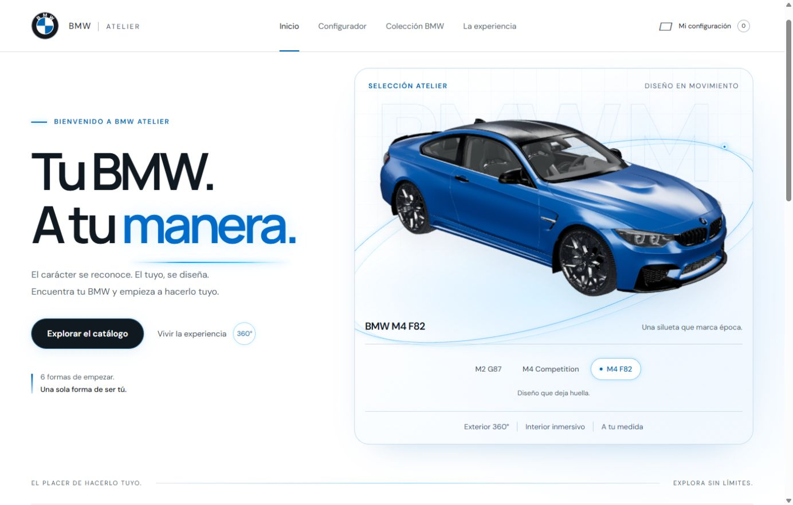
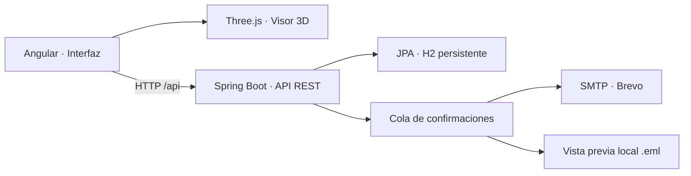

# BMW Atelier

### El placer de hacerlo tuyo.

**Showroom digital y configurador 3D de vehículos BMW, desarrollado con Angular, Three.js y Spring Boot.** Explora el exterior, entra en el habitáculo y personaliza los acabados antes de continuar con un pedido de demostración mediante QR.

[](https://github.com/gabrielsuarezdevv/concesionario-bmw/actions/workflows/ci.yml)




**Estado:** V1 funcional en local. El despliegue público está pendiente; todavía no hay una URL de demostración online.

> Proyecto personal e independiente, sin afiliación con BMW AG. Los precios y los pedidos son de demostración. No se realizan cobros ni compraventas reales.

[Características](#características) · [Instalación](#instalación-local) · [Docker](#ejecución-con-docker) · [API](#api-rest) · [Pruebas](#pruebas-y-ci) · [Créditos](#créditos-y-licencias)

## El proyecto

BMW Atelier lleva la experiencia de un concesionario a una interfaz donde el vehículo se puede explorar y configurar en tiempo real. La propuesta combina una presentación visual cuidada con un flujo completo entre navegador, API, persistencia y confirmación por correo.

El reto principal es mantener una experiencia 3D fluida con modelos detallados, conservar la coherencia entre exterior e interior y validar las configuraciones y los pedidos en el servidor.

## Características

### Explorar

- Página de inicio con selección de modelos destacados, transiciones y acceso al catálogo.
- Catálogo de seis vehículos con renders PNG de fondo transparente.
- Visor exterior 360° con rotación, zoom, restablecimiento de cámara y giro automático opcional.
- Cámara interior con control de la mirada y ajuste del campo de visión.
- Escenarios **Día y Noche**, con iluminación y reflejos neutros para conservar mejor el matiz de la pintura.
- Ficha técnica por modelo, con versión de serie de referencia y enlaces a fuentes de BMW.

### Personalizar

- **12 colores de carrocería**, **2 acabados de llantas** y **5 ambientes de tapicería**.
- Actualización de materiales y presupuesto al cambiar la selección.
- Vista de despiece animada por grupos visuales, activada manualmente.
- Enlaces para compartir la configuración, restauración local y exportación a JSON.
- Diseño adaptable a escritorio y móvil, controles de teclado y respeto por la preferencia de movimiento reducido.

### Completar un pedido de demostración

- Resumen de la configuración con botón **Comprar** y generación de un QR.
- Formulario móvil con nombre completo, edad y correo electrónico.
- Validación de mayoría de edad tanto en Angular como en Spring Boot.
- Precio calculado por el backend a partir del catálogo, sin confiar en importes del navegador.
- Sesiones de compra de 30 minutos y protección frente a pedidos duplicados.
- Confirmación por correo mediante SMTP, con integración preparada para Brevo y reintentos de envío.
- Modo local de correo para probar el flujo sin enviar mensajes reales.

Los cambios de pintura, llantas o tapicería **no activan el despiece automáticamente**.

## Vehículos disponibles

| Vehículo | Identificador | Versión utilizada como referencia técnica |
| --- | --- | --- |
| BMW M4 Competition | `m4` | M4 Competition M xDrive Coupé G82 · 2024 |
| BMW 330i E46 | `e46` | 330i Berlina E46 · 2000 · Manual |
| BMW M2 G87 | `m2` | M2 Coupé G87 · 2023 · M Steptronic |
| BMW M3 E92 | `e92` | M3 Coupé E92 · 2007 · Manual |
| BMW X6 xDrive40i | `x6` | X6 xDrive40i G06 · 2020 · Steptronic |
| BMW M4 F82 | `f82` | M4 Coupé F82 · 2014 · M DKG |

Los recursos 3D pueden incorporar modificaciones estéticas o mecánicas de sus autores. Las fichas describen las versiones de serie indicadas; no son mediciones de esos recursos ni garantizan una correspondencia exacta con ellos. El E46 del catálogo es una berlina 330i de cuatro puertas.

## Tecnologías

| Capa | Tecnologías y responsabilidad |
| --- | --- |
| Interfaz | Angular 21, TypeScript, componentes standalone, Signals, formularios reactivos y CSS |
| Gráficos | Three.js 0.181, WebGL, modelos GLB/glTF, materiales físicos y sombras de contacto |
| Backend | Java 21, Spring Boot 3.5, Spring Web y Bean Validation |
| Persistencia | Spring Data JPA y H2 en archivo |
| Correo | Spring Mail, SMTP y perfil de configuración para Brevo |
| Pruebas | Node Test Runner, JUnit, Spring Boot Test y decodificación independiente del QR |
| Herramientas | Maven Wrapper, npm, Docker Compose, Git y GitHub Actions |

## Arquitectura



En desarrollo, Angular se ejecuta en el puerto **4200** y reenvía `/api` a Spring Boot en el **8080** mediante el proxy incluido. El navegador utiliza un único origen y no necesita una configuración adicional de CORS.

La imagen Docker compila Angular e incorpora su salida como recursos estáticos de Spring Boot. En esa modalidad, la web y la API se sirven juntas desde el puerto **8080**.

## Instalación local

### Requisitos

- **Node.js 24** y npm.
- **JDK 21** recomendado, con `JAVA_HOME` configurado.
- Git.

El repositorio incluye Maven Wrapper, que descarga Maven 3.9.11 en la primera ejecución. No hace falta instalar Maven por separado. El primer arranque requiere conexión a Internet para descargar dependencias.

### 1. Clonar la V1

La versión documentada se encuentra actualmente en la rama `feat/bmw-atelier`.

```sh
git clone --branch feat/bmw-atelier https://github.com/gabrielsuarezdevv/concesionario-bmw.git
cd concesionario-bmw
```

### 2. Iniciar el backend

En una terminal, desde la raíz del repositorio:

```powershell
cd backend
.\mvnw.cmd spring-boot:run
```

En macOS o Linux, utiliza `./mvnw spring-boot:run`.

### 3. Iniciar el frontend

En otra terminal, desde la raíz del repositorio:

```sh
cd frontend
npm ci
npm start
```

| Servicio | Dirección |
| --- | --- |
| Aplicación | <http://127.0.0.1:4200> |
| Estado de la API | <http://127.0.0.1:8080/api/health> |
| Catálogo de la API | <http://127.0.0.1:8080/api/catalog> |

Por defecto, el backend utiliza H2 y el modo de correo `preview`: se puede recorrer el flujo completo de pedido sin configurar un servicio de email. Los datos se guardan en `backend/data/`, fuera del control de versiones.

## Ejecución con Docker

Requiere Docker Engine o Docker Desktop con Docker Compose. No requiere instalar Node.js ni Java en el equipo anfitrión.

Desde la raíz del repositorio:

```sh
docker compose up --build -d
docker compose logs -f atelier
```

Abre <http://127.0.0.1:8080>. Para detener la aplicación:

```sh
docker compose down
```

El volumen `atelier-data` conserva la base de datos entre arranques. `docker compose down` mantiene el volumen; añadir `-v` elimina también esos datos. El servicio se publica solo en la interfaz local del equipo y el proceso del contenedor se ejecuta con un usuario sin privilegios.

La receta Docker está incluida en el repositorio; su construcción completa no se ha validado en este equipo. El despliegue remoto se verificará por separado.

## Configuración y correo

### Variables de entorno

| Variable | Uso | Valor predeterminado de la aplicación |
| --- | --- | --- |
| `PORT` | Puerto HTTP de Spring Boot | `8080` |
| `DATABASE_URL` | URL JDBC de la base de datos | H2 en `./data/atelier` |
| `DATABASE_USERNAME` | Usuario de la base de datos | `sa` |
| `DATABASE_PASSWORD` | Contraseña de la base de datos | Vacía, para desarrollo local |
| `CHECKOUT_PUBLIC_URL` | Origen público de la web para los enlaces del QR | Vacío; se utiliza una ruta relativa |
| `ORDER_MAIL_MODE` | `preview` o `smtp` | `preview` |
| `ORDER_MAIL_FROM` | Dirección del remitente | `pedidos@bmw-atelier.test` |
| `ORDER_MAIL_PREVIEW_DIRECTORY` | Carpeta de archivos `.eml` | `./data/mail-preview` |
| `ORDER_MAIL_DISPATCH_ENABLED` | Activar el procesamiento de correos pendientes | `true` |
| `SMTP_HOST` | Servidor SMTP | `127.0.0.1` |
| `SMTP_PORT` | Puerto SMTP | `587` |
| `SMTP_USERNAME` / `SMTP_PASSWORD` | Credenciales SMTP | Sin configurar |
| `SMTP_AUTH` / `SMTP_STARTTLS` | Autenticación y STARTTLS obligatorio | `true` |
| `SMTP_SSL` | TLS implícito | `false` |

Estas variables corresponden a la aplicación. `compose.yaml` reenvía las variables de correo y la URL pública que declara; para añadir otras, amplía su bloque `environment`. En Docker, cambiar `PORT` también requiere ajustar el puerto publicado.

### Probar sin enviar correos

Con `ORDER_MAIL_MODE=preview`, cada confirmación genera un archivo `.eml`. En desarrollo se guarda en `backend/data/mail-preview/`; en Docker, dentro del volumen de datos. La interfaz diferencia un correo preparado localmente de uno enviado por SMTP.

### Activar Brevo

Necesitas una cuenta de Brevo, un remitente verificado, el login SMTP y una **clave SMTP**. Una clave SMTP es distinta de la contraseña de la cuenta y de una clave de API.

**En Docker:** copia el archivo de ejemplo, completa sus campos y cambia `ORDER_MAIL_MODE` a `smtp`.

```powershell
Copy-Item .env.example .env
```

El ejemplo ya contiene el servidor `smtp-relay.brevo.com`, el puerto `587` y STARTTLS. Después, inicia o recrea el servicio con `docker compose up --build -d`. Docker Compose lee `.env`; Java y Maven no lo cargan automáticamente.

**En Windows, sin Docker:** compila primero el backend con `.\mvnw.cmd verify` desde `backend`. Después, desde la raíz:

```powershell
powershell -File .\scripts\configure-brevo.ps1
powershell -File .\scripts\start-brevo.ps1
```

El asistente solicita la clave con entrada oculta y la guarda cifrada con DPAPI para el usuario de Windows. El lanzador inicia el JAR con el perfil `brevo`; detén antes cualquier backend que ocupe el puerto 8080. Los archivos de configuración permanecen en `backend/data/` y no se suben a Git.

**En otros entornos:** define `ORDER_MAIL_FROM`, `SMTP_USERNAME` y `SMTP_PASSWORD` en el entorno del proceso y arranca el JAR con `--spring.profiles.active=brevo`.

Mantén las credenciales fuera del código, del frontend y de las capturas de pantalla. Consulta [la configuración SMTP de Brevo](https://help.brevo.com/hc/en-us/articles/7924908994450-Send-transactional-emails-using-Brevo-SMTP) para obtener los datos de tu cuenta.

## Probar el QR desde un móvil

Un QR que apunta a `localhost` no permite acceder al ordenador desde el teléfono: esa dirección identifica al propio dispositivo. Para probarlo en una red local, conecta ambos equipos a la misma red y utiliza una IPv4 privada del ordenador.

1. Mantén Spring Boot iniciado en `127.0.0.1:8080`.
2. Desde la raíz, compila Angular y arranca el puente de vista previa:

   ```sh
   npm --prefix frontend run build
   node scripts/checkout-preview.cjs --host 192.168.1.20
   ```

3. Sustituye `192.168.1.20` por tu dirección real y abre `http://192.168.1.20:4300` en el navegador.
4. Configura un coche, pulsa **Ver mi configuración → Comprar** y escanea el QR.

Deja `CHECKOUT_PUBLIC_URL` vacío para utilizar el origen desde el que abres la web o configúralo con esa misma dirección, sin fragmentos ni parámetros. Una URL pública antigua en esa variable hará que el QR apunte al destino incorrecto.

El puente sirve la compilación y reenvía su API. No publica la carpeta de datos ni modifica el firewall. Una red con aislamiento entre dispositivos o un firewall que bloquee el puerto puede impedir la conexión. Detén el puente con `Ctrl+C` al finalizar.

## API REST

| Método | Ruta | Función |
| --- | --- | --- |
| `GET` | `/api/health` | Consultar el estado del servicio |
| `GET` | `/api/catalog` | Obtener vehículos y opciones |
| `POST` | `/api/quotes` | Validar una selección y calcular su presupuesto |
| `POST` | `/api/configurations` | Guardar una configuración |
| `GET` | `/api/configurations/{id}` | Recuperar una configuración por UUID |
| `POST` | `/api/checkouts` | Crear una sesión de compra y su enlace |
| `GET` | `/api/checkouts/{id}` | Consultar la configuración y el estado del pedido |
| `POST` | `/api/checkouts/{id}/orders` | Registrar los datos del comprador y preparar la confirmación |

### Configuración de ejemplo

Este cuerpo se utiliza para presupuestos, configuraciones guardadas y sesiones de compra:

```json
{
  "model": "m4",
  "paint": "green",
  "wheels": "forged",
  "interior": "cognac"
}
```

El servidor calcula un total de demostración de **130.600 EUR** para esa selección. Los identificadores válidos y sus precios se obtienen de `/api/catalog`.

### Confirmación de ejemplo

El UUID debe proceder de una sesión creada previamente. El cuerpo para `/api/checkouts/{id}/orders` es:

```json
{
  "fullName": "Persona de prueba",
  "age": 25,
  "email": "persona@example.com"
}
```

Los errores relevantes son `400` para datos no válidos, `404` para registros inexistentes, `409` para un QR ya utilizado con otros datos y `410` para una sesión abierta caducada o un modelo retirado.

## Integridad del pedido

Al generar el QR, el backend conserva una instantánea del vehículo, los acabados y el precio. El enlace caduca a los **30 minutos** si todavía no se ha confirmado el pedido.

La confirmación exige una edad entera de **18 años o más**, declarada por el usuario. No hay verificación documental de identidad. Repetir la misma solicitud devuelve la referencia existente; las transacciones y los bloqueos evitan crear varios pedidos para el mismo QR ante solicitudes simultáneas.

Los datos del comprador se guardan en la base de datos y no aparecen en el QR ni en las respuestas públicas de consulta. Los enlaces conocidos permiten recuperar configuraciones y estados; no hay un sistema de cuentas ni un listado público de pedidos.

La confirmación por correo se procesa a partir de registros persistentes. Si falla SMTP, el pedido se conserva y el envío se intenta hasta **cinco veces** en total. El estado distingue pendiente, enviado, vista previa y fallo. Un correo marcado como enviado ha sido aceptado por el servidor SMTP; no implica una entrega garantizada en la bandeja de entrada.

## Rendimiento 3D

El visor utiliza varias medidas para reducir trabajo innecesario:

- **Renderizado bajo demanda:** se detiene en reposo, fuera de pantalla o al ocultar la pestaña.
- **Carga de modelos bajo demanda:** cada GLB se descarga al seleccionarlo; el código del visor se difiere hasta entrar al showroom.
- **Agrupación de geometrías opacas:** reduce llamadas de dibujo conservando materiales y movimientos de despiece. Las transparencias mantienen su separación para ordenar correctamente su renderizado.
- **Resolución adaptativa:** limita la densidad de píxeles, reduce la resolución durante la interacción y la recupera al detenerse.
- **Animación limitada a 60 FPS:** evita trabajo adicional en pantallas de alta frecuencia.
- **Recursos reutilizados:** los mapas de reflejos de cada escenario se generan localmente y se conservan para los siguientes cambios.

La fluidez depende de la GPU, la aceleración gráfica del navegador y la complejidad del modelo. No se afirma una tasa de FPS garantizada para todos los dispositivos.

En desarrollo, añade `viewerStats=1` a la URL para mostrar FPS, resolución, llamadas de dibujo y contador de fotogramas. Ese diagnóstico no se muestra en la compilación de producción.

## Pruebas y CI

Desde `frontend`:

```sh
npm run build
npm run test:qr
npm run test:viewer
```

Desde `backend`, en Windows:

```powershell
.\mvnw.cmd verify
```

En macOS o Linux, utiliza `./mvnw verify`.

Las comprobaciones cubren:

- **QR:** generación y lectura con una biblioteca de decodificación independiente.
- **Visor:** conservación de geometría y materiales, despiece, variantes de ruedas, transparencias, tapicería, escenarios, liberación de recursos, resolución y cadencia de fotogramas.
- **API y pedidos:** precios, validaciones, mayoría de edad, caducidad, concurrencia, unicidad de pedidos y reintentos de correo.

Las pruebas del visor verifican geometría y decisiones de renderizado sin necesitar un contexto WebGL. La revisión visual del 3D y las pruebas en dispositivos complementan esa cobertura.

El workflow [Build and test](.github/workflows/ci.yml) compila Angular, ejecuta las comprobaciones del QR y del visor, y verifica el backend en cada pull request y en los pushes a `main` o `feat/**`.

## Estructura del repositorio

```text
concesionario-bmw/
├── frontend/
│   ├── src/app/            # Interfaz, catálogo, visor 3D y pedido móvil
│   ├── public/models/      # Modelos GLB, previews y atribuciones
│   ├── public/textures/    # Texturas y créditos
│   └── scripts/            # Pruebas de QR y visor
├── backend/
│   ├── src/main/           # API, catálogo, persistencia y correo
│   ├── src/test/           # Pruebas del backend
│   └── data/               # Datos locales; ignorados por Git
├── scripts/                # Brevo, vista previa móvil y preparación de assets
├── docs/                   # Descripción para portfolio e imágenes del README
├── .github/workflows/      # Integración continua
├── .env.example            # Plantilla de configuración local de correo
├── Dockerfile              # Compilación de frontend y backend en una imagen
└── compose.yaml            # Servicio local y volumen persistente
```

## Estado y siguientes pasos

La V1 implementa la experiencia visual, la configuración y el pedido de demostración. **Railway es el destino previsto, pero todavía no se ha desplegado.**

Antes de publicar la aplicación quedan por validar la imagen Docker en el entorno de destino, el almacenamiento persistente, las copias de seguridad y la configuración pública de HTTPS, QR y correo. PostgreSQL requiere añadir su controlador y preparar la configuración y las migraciones; no está integrado actualmente.

El correo implementado utiliza **SMTP**. Un despliegue cuyo proveedor bloquee SMTP necesitará adaptar el envío a una API HTTPS; esa integración todavía no forma parte de esta V1.

Para convertir el prototipo en un servicio comercial también hacen falta un catálogo y unos precios reales, permisos de uso comercial de todos los recursos, administración y controles de acceso, límites de uso de la API y una política de tratamiento y conservación de datos.

## Créditos y licencias

Los modelos 3D son recursos de terceros integrados y adaptados para esta experiencia. Su autoría no se atribuye al desarrollador de la aplicación.

| Recurso | Autor | Licencia |
| --- | --- | --- |
| M4 Competition M Package | SRT Performance | CC BY 4.0 |
| 330i E46 Berlina | Merc_TV | CC BY 4.0 |
| M2 G87 | Black Snow | CC BY 4.0 |
| M3 E92 stance | Black Snow | CC BY 4.0 |
| X6 xDrive40i | Ddiaz Design | **CC BY-NC-SA 4.0** |
| M4 F82 | Black Snow | CC BY 4.0 |
| Leather White | Rob Tuytel / Poly Haven | CC0 1.0 |

Los originales, las fuentes de redistribución y los cambios realizados están documentados en [créditos de modelos](frontend/public/models/ATTRIBUTION.md) y [créditos de texturas](frontend/public/textures/ATTRIBUTION.md). Los renders derivados conservan las condiciones de sus recursos de origen. Las tipografías DM Sans y Manrope incluyen sus licencias en los paquetes de Fontsource.

**El X6 y sus derivados están limitados a uso no comercial por su licencia.** El despiece es una separación visual ilustrativa, no un procedimiento mecánico exacto. Los modelos no son gemelos digitales certificados ni un catálogo oficial de piezas BMW.

El repositorio no incluye actualmente una licencia general para el código de la aplicación. Las licencias de los recursos de terceros se mantienen de forma independiente. Las marcas y nombres de BMW pertenecen a sus titulares.

## Autor

**Gabriel Suárez** · [GitHub](https://github.com/gabrielsuarezdevv)

Proyecto de desarrollo full stack centrado en interacción 3D, experiencia de usuario y conexión entre frontend y backend. La presentación lista para el portfolio está en [docs/PORTFOLIO.md](docs/PORTFOLIO.md).
